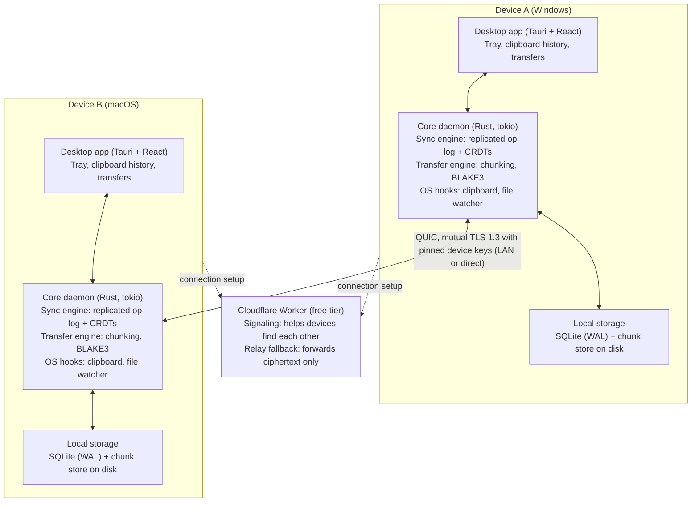

# Tether: Cross-Device Workspace Design Doc

Last updated: 2026-11-23. Exported from the shared design doc; diagrams converted to Mermaid.

## Summary and goals

Tether is a peer-to-peer, end-to-end encrypted desktop app that syncs your clipboard, files, links and workspace sessions across Windows, macOS and Linux, with no server holding your data. Its core is a replicated operation log, proven correct by a deterministic simulation harness.

**Goals**

- Copy on one machine, paste on another in under 50 ms on the same network.
- Send files of any size directly between devices, resuming after any interruption.
- Stay correct when devices go offline, edit concurrently, crash or rejoin.
- Resume a workspace (open tabs, files, terminal folders) on another machine.
- Run at $0: everything is local, and the only hosted pieces fit a free tier.

**Non-goals for v1**

- Mobile apps. iOS restricts background clipboard access; mobile comes last.
- Real-time co-editing of documents in other apps. Tether syncs items and state, not keystrokes inside other apps. (Changed 2026-11-23: Tether's own Notes, F11 in ROADMAP.md, are co-edited live, by deliberate choice.)
- Accounts, cloud storage or a web app. Identity is a device keypair, and data lives only on your devices.

## Problems it solves

Moving work between your own computers is still clumsy unless every device is made by Apple. Tether removes the workarounds people use today.

| Today's workaround | Why it hurts | What Tether does |
| --- | --- | --- |
| Emailing or messaging yourself files and links | Slow, size limits, clutters inboxes, data passes through third parties | Direct device-to-device transfer, end-to-end encrypted |
| Uploading to Google Drive or Dropbox to move one file | Upload then download doubles the time; needs internet even when both devices sit on one desk | Transfers at local-network speed, no internet needed |
| Retyping text seen on another screen | Error-prone, breaks focus | Shared clipboard with searchable history across devices |
| Re-opening the same tabs and files on a second machine | Minutes of setup every switch | One-click workspace resume |
| Transfers that fail at 90% | Start over from zero | Chunked, resumable transfers pick up where they stopped |

**How it differs from existing tools**

| Tool | Gap Tether fills |
| --- | --- |
| Apple Continuity | Apple devices only; Tether covers Windows, macOS and Linux |
| LocalSend | One-off file sends; no clipboard history, sync or workspace state |
| KDE Connect | Mostly Linux and Android; no proven offline correctness |
| Syncthing | Syncs folders only; no clipboard, links or sessions |

The engineering differentiator is correctness: Tether publishes simulation results showing devices always converge after partitions, crashes and concurrent edits. None of these tools publish anything comparable.

## User experience

Tether has a real UI: a native desktop app with a tray icon, a main window and a CLI. There is no web app, because a web page cannot read your clipboard in the background, open direct peer-to-peer sockets or watch your files.

**1. Tray / menu-bar icon (always running)**

- Shows connected devices and sync status at a glance.
- Quick actions: "Send file to…", "Push clipboard to…", "Pause sync".
- Toast notifications: "Received report.pdf from Desktop (42 MB)" with Open / Show in folder.

**2. Main window**

- **Clipboard history:** every copied item from every device, searchable, with source device and time. Pin items; mark sensitive ones to never sync.
- **Transfers:** drag a file onto a device to send it; live progress, speed and resume state.
- **Devices:** pair a new device by scanning a QR code or typing a 6-digit code; rename or revoke devices.
- **Workspaces:** saved snapshots (tabs, open files, terminal folders) with a "Resume here" button.
- **Diagnostics:** connection type (LAN, direct internet, relay), latency per peer, log replication lag. This doubles as a live demo of the internals.

**3. Global hotkeys**

- Copy as usual; Tether syncs automatically (configurable per device).
- A hotkey opens a search palette over clipboard history from all devices.

**4. CLI (`tether`)**

- `tether send report.pdf --to desktop`, `tether clip push`, `tether status`, `tether pair`.
- Useful for scripts and for the simulation harness.

**First-run flow:** install on two machines → each shows a pairing code → enter it on the other → devices exchange keys → clipboard sync is on. Target: under 60 seconds.

## Architecture overview

Every device runs the same three layers, and devices talk to each other directly. The only cloud piece helps them find each other and relays encrypted bytes when a direct path is impossible.

**Data flow for one copy-paste:** you copy on Device A → the OS hook fires → the sync engine appends a signed operation to A's log and SQLite in one transaction → it is pushed over the open QUIC stream → Device B verifies, stores and applies it → B's clipboard and history update.

The daemon keeps running when the window is closed; the UI is just a client of it. Large files go through the transfer engine on separate QUIC streams so they never block clipboard sync.

## Tech stack

Rust for everything performance- or correctness-critical, TypeScript only for the UI. Total hosting cost: $0.

| Layer | Choice | Why |
| --- | --- | --- |
| Core daemon | Rust + tokio | Memory safety without GC pauses; async I/O for many concurrent peers and transfers |
| Transport | QUIC via `quinn` | Multiplexed streams (clipboard never waits behind a big file), built-in TLS 1.3, connection migration when Wi-Fi changes |
| LAN discovery | mDNS via `mdns-sd` | Devices find each other with zero configuration |
| Internet connectivity | STUN + UDP hole punching; relay fallback | Direct connections where NAT allows, relay otherwise |
| Signaling and relay | Cloudflare Workers + Durable Objects (free tier) | Brokers connection setup only; sees encrypted bytes, never content |
| Pairing and encryption | Ed25519 device keys; mutual TLS 1.3 (rustls) with pinned keys; SPAKE2 on a short code, bound to the TLS channel | Mutual authentication without accounts or a certificate authority. Chosen over a separate Noise layer (decided in P0): QUIC already provides TLS 1.3, so only a password-authenticated key exchange was missing |
| Sync model | Own replicated operation log + CRDTs (own LWW-register and OR-set; Automerge for rich workspace state) | The core of the project; writing it yourself is the point |
| Local storage | SQLite (WAL mode) via `rusqlite`; content-addressed chunk store on disk | Crash-safe, embedded, zero ops |
| Hashing | BLAKE3 | Very fast content addressing for chunks and dedup |
| Clipboard / OS hooks | `arboard`, `notify` (file watching), per-OS APIs | Cross-platform clipboard and file events |
| Desktop UI | Tauri 2 + React + TypeScript | Native-size binaries (~10 MB vs ~150 MB Electron); Rust backend shares the core crate |
| IPC (UI ↔ daemon) | Tauri commands + event stream | Daemon keeps running when the window closes |
| Testing | Own deterministic simulator; `proptest`; `loom` for lock-level concurrency | Proves convergence and catches race conditions |
| Observability | `tracing` + OpenTelemetry exporters; built-in diagnostics view | Latency histograms and replication lag per peer |
| CI / release | GitHub Actions (free for public repos); signed builds for 3 OSes | Every PR runs thousands of simulated scenarios |

## Core design: the replicated operation log

Every change is an immutable operation appended to its author device's log; devices sync by exchanging the operations the other side has not seen. This is Kafka's core idea (append-only logs, offsets, compaction) applied peer-to-peer.

**Data model**

- Each device has an ID (its public key) and its own append-only log. An operation = `(device_id, seq, hlc_timestamp, op_type, payload, hash)`.
- `seq` increases by one per device, so `(device_id, seq)` uniquely names every operation. Like a Kafka offset, but one per device.
- `hlc_timestamp` is a hybrid logical clock: wall time plus a counter, so ordering survives clock skew between machines.
- Each operation is signed by its device key, so a relay or compromised peer cannot forge history.

**Operation types and their merge rules (CRDTs)**

| State | CRDT | Concurrent-edit rule |
| --- | --- | --- |
| Clipboard history | Append-only grow set, ordered by HLC | Both items kept; newest on top |
| Pinned / deleted items | Observed-remove set | A delete removes only what that device had seen; a concurrent re-pin wins |
| Device names, settings | Last-writer-wins register (HLC) | Latest HLC wins; ties broken by device ID |
| Workspace snapshots | Automerge document | Field-level merge |
| File manifests | Content hash → chunk list (immutable) | No conflicts: same content = same hash |

**Sync protocol**

1. On connect, peers exchange **version vectors**: for each device, the highest `seq` held. This is a few bytes per device.
2. Each side streams the operations the other is missing, in `seq` order per device, over a dedicated QUIC stream.
3. Receivers verify signature and hash, write to SQLite in one transaction, then apply to in-memory state. Duplicates are no-ops (idempotent by `(device_id, seq)`).
4. While connected, new operations are pushed immediately (live tail), so clipboard latency is one network hop.
5. Gossip: a device relays operations from devices that are offline, so A's change reaches C through B.

**Hard cases the design must handle**

- **Two devices copy at the same instant:** both items land in history in the same order everywhere (HLC + device-ID tiebreak).
- **Delete on A while B is offline and pins the same item:** OR-set semantics; the result is the same on every device after reconnect.
- **Crash between receiving and applying:** the SQLite write and the version-vector update share one transaction, so the op is either fully applied or re-requested.
- **Revoked device:** its future operations are rejected; past ones remain, because history is immutable.

**Compaction**

Logs grow forever unless trimmed. Once every known device's version vector covers an operation, it is folded into a snapshot and dropped from the log, like Kafka log compaction keyed by item ID. Clipboard history also keeps a size cap (e.g. last 1,000 items or 30 days).

## Networking, discovery and security

Devices try the fastest path first: same network, then a direct internet connection, then an encrypted relay. All three carry the same end-to-end encrypted QUIC traffic.

**Connection ladder**

1. **LAN:** each device advertises `_tether._udp` over mDNS with its device ID. Paired peers connect directly. Typical setup time: tens of milliseconds.
2. **Direct over the internet:** both devices learn their public address from a STUN server, exchange candidates through the signaling Worker, and send UDP packets at each other simultaneously to open their NATs (hole punching). Works on most home networks.
3. **Relay:** when both sides are behind strict NATs (some corporate or mobile networks), traffic flows through a Cloudflare relay. It forwards ciphertext only and is rate-limited to stay in the free tier.

QUIC connection migration keeps sessions alive when a laptop moves from Wi-Fi to a hotspot. The daemon reconnects with exponential backoff and jitter, and resumes sync from the version vector.

**Pairing**

- Each device generates an Ed25519 identity key on first launch, stored in the OS keychain.
- Pairing uses a short code (QR later) to run SPAKE2, a password-authenticated key exchange, bound to the TLS channel's exported keying material, so a 6-digit code cannot be brute-forced offline and a relay in the middle is detected. Three attempts per two-minute window.
- After pairing, devices pin each other's public keys. Every later connection is mutually authenticated by those keys.

**Threat model**

| Threat | Mitigation |
| --- | --- |
| Someone on the same Wi-Fi sniffs traffic | All traffic encrypted and mutually authenticated (QUIC TLS 1.3 with pinned device keys) |
| Signaling or relay server is compromised | It only sees encrypted bytes and device IDs; cannot read or forge operations |
| Attacker impersonates a device | Pinned keys; every operation signed |
| Lost or stolen laptop | Revoke it from any other device; keys rotate; revoked device's new operations are rejected |
| Sensitive clipboard (passwords) | Detect password-manager clipboard flags; never sync items marked sensitive; auto-expire |
| Malicious file from a paired device | Files land in a quarantine folder; nothing auto-executes |

## File transfer

Files are split into content-addressed chunks, so transfers resume after any interruption, never re-send data the receiver already has, and can pull from several devices at once.

**How a send works**

1. The sender splits the file with **content-defined chunking** (FastCDC, ~1 MB average). Boundaries depend on content, so editing the start of a file does not shift every later chunk.
2. Each chunk is hashed with BLAKE3. The file becomes a **manifest**: name, size, ordered chunk hashes, and a root hash.
3. The manifest travels as an operation in the log, so every paired device learns the file exists.
4. The receiver checks which chunk hashes it already has (dedup) and requests only the missing ones.
5. Chunks stream over parallel QUIC streams; each is verified against its hash before being written.
6. When all chunks are present, the file is assembled atomically: write to a temp file, fsync, rename.

**Resumability:** received chunks persist in the chunk store. After a drop, crash or reboot, the receiver re-requests only what is missing.

**Concurrency and flow control**

- A bounded window of in-flight chunks per peer (e.g. 16) keeps memory flat for a 50 GB file.
- Clipboard and log sync run on a separate high-priority QUIC stream, so a large transfer never delays a paste.
- With 3+ devices, chunks can be fetched from whichever peers have them, BitTorrent-style, with a scheduler that favours the fastest peer.
- Backpressure: if disk writes fall behind the network, the window shrinks instead of buffering in RAM.

**Race conditions to design for**

- The sender modifies the file mid-transfer: the manifest is a snapshot; a changed file produces a new manifest, and chunks that fail verification are discarded.
- The same file is sent from two devices at once: identical content means identical hashes, so the transfers merge.
- The receiver deletes a half-received file while chunks are still arriving: cancellation token per transfer; in-flight writes are dropped and orphan chunks are garbage-collected.

## Correctness: deterministic simulation testing

The whole sync engine runs inside a simulator that controls time, randomness and the network, so thousands of failure scenarios run in seconds and any failure can be replayed exactly from its seed. This is the approach FoundationDB and TigerBeetle use, and it is what makes this project stand out.

**How it works**

- The core is written against traits for `Clock`, `Network`, `Storage` and `Rng`. Production uses real implementations; tests use simulated ones.
- One test run = one seed. The seed drives every random choice: message delays, drops, reordering, crash points, which device acts next.
- A single-threaded scheduler runs N simulated devices in one process, so a run is fully deterministic: same seed, same result, every time.
- A failing seed is a bug report: rerun it under a debugger and step through the exact interleaving.

**Faults injected**

- Network: partitions, packet loss, duplication, reordering, latency spikes, asymmetric links (A hears B but not vice versa).
- Process: crash at any await point, restart from disk, crash during a SQLite write.
- Storage: torn writes, full disk, slow fsync.
- Clocks: skew of minutes between devices, clocks jumping backwards.
- Users: concurrent copies, deletes, pins, pairing and revocation mid-sync.

**Invariants checked after every run**

1. **Convergence:** once the network heals and devices go quiet, every device has identical state (compare state hashes).
2. **No loss:** every operation acknowledged on any device eventually appears on all non-revoked devices.
3. **No duplication:** each `(device_id, seq)` is applied at most once.
4. **Integrity:** every assembled file matches its manifest root hash.
5. **Causality:** an operation never appears before an operation it depends on.
6. **Security:** operations from revoked devices after revocation are never applied.

**Supporting tools**

- `proptest` for property-based tests on CRDT merge functions (commutative, associative, idempotent).
- `loom` to exhaustively check lock-level interleavings in the few places that use shared memory (chunk store, transfer scheduler).
- CI runs 10,000 seeds per pull request and a nightly run of 1M+. Publish the counts and every bug found, with its seed, in the README.

## Performance targets and benchmarks

These are targets to measure against, not results yet. Publish the real numbers, with hardware and method, in the README; the gap between target and actual is itself a good interview story.

| Metric | Target | How to measure |
| --- | --- | --- |
| Clipboard copy → available on peer (LAN) | p50 < 50 ms, p99 < 150 ms | Timestamped copy events on two machines; HLC-corrected |
| Clipboard latency (direct internet) | p50 < RTT + 30 ms | Same, across two networks |
| File throughput (1 Gbps LAN) | ≥ 80% of link speed | 10 GB file, `iperf3` as baseline |
| Resume after drop | < 1 s to resume; 0 bytes re-sent for completed chunks | Kill the connection at random points |
| Reconnect after network change | < 2 s | Toggle Wi-Fi / hotspot |
| Daemon idle footprint | < 30 MB RAM, ~0% CPU | OS process monitor over 24 h |
| Sync after 1 week offline (10k ops) | < 3 s | Simulator + real devices |
| Simulated scenarios per CI run | 10,000 seeds, 0 invariant violations | Simulation harness |

Profile with `tokio-console`, `perf` / `samply` flamegraphs and `criterion` microbenchmarks. Track the numbers per commit so regressions show up in CI.

## Milestones and roadmap

Stages 1–4 take about 16 weeks part-time and end in a public v1; every stage leaves you with something usable.

| Stage | Weeks | Ships | Done when |
| --- | --- | --- | --- |
| 1 · LAN clipboard and files | 1–3 | Pairing, mDNS, QUIC, clipboard push, file send, tray app | You copy on one machine and paste on the other daily |
| **2 · Replicated log + simulator (the core)** | 4–9 | Op log, version vectors, CRDTs, deterministic simulator | 10k simulated seeds pass in CI with zero violations |
| 3 · Internet + resumable files | 10–13 | Signaling Worker, hole punching, relay, chunked transfers | Sync works between two different networks |
| 4 · Workspace resume | 14–16 | Tab, file and terminal snapshots; browser extension | One click restores your workspace on another machine |
| **Gate: public v1 with published benchmarks** | | | |
| 5 · Shared spaces | 17–20 | Spaces shared with friends or teammates, per-space keys | Three people share a space with offline edits |
| 6 · Mobile | After v1 | Android first (easier clipboard access), then iOS | Your phone sends and receives files and links |

Stage 2 is where most side projects stall, and it is what makes this one exceptional, so give it the most time. Ship stage 1 publicly first so the repo shows progress while you build the core.

**First week, concretely** (status as of 2026-11-23)

- [x] Create a Cargo workspace: `tether-core`, `tether-daemon`, `tether-sim`. (`tether-cli` and the Tauri app are not started.)
- [x] Two processes on one machine discover each other over mDNS and open a QUIC connection.
- [x] Copy text in one, see it printed in the other; log the latency.
- [x] Write the README with the goal and an empty benchmarks table to fill in. (Architecture diagram not yet added to the README.)

## Risks, open questions and talking points

**Risks**

| Risk | Likelihood | Fallback |
| --- | --- | --- |
| Stage 2 (log + simulator) takes far longer than planned | High | Ship stage 1 publicly first; the simulator can start with 3 devices and network faults only |
| NAT hole punching fails on many networks | Medium | Relay fallback; publish success rate by network type as a finding |
| Clipboard APIs differ by OS (Wayland is restrictive) | Medium | Support X11 + Windows + macOS first; Wayland via portal later |
| Free relay tier limits | Low | Relay only connection setup + small payloads; large files require direct or LAN |
| Scope creep into mobile or co-editing | Medium | Non-goals list; mobile stays stage 6 |

**Open questions**

- [ ] Write the CRDTs by hand, or use Automerge for everything? Recommendation: hand-write clipboard and settings, Automerge for workspaces.
- [ ] Which browsers to support for tab capture in workspace resume (needs an extension)?
- [ ] Name check: is "Tether" free on crates.io and GitHub?

**Interview talking points this project gives you**

- Designing a replicated log: offsets, version vectors, idempotency, compaction. The same concepts as Kafka, from first principles.
- CRDTs and the trade-offs of each merge rule.
- Finding race conditions with deterministic simulation; the worst bug the simulator found, and its seed.
- NAT traversal and why QUIC beats TCP here (head-of-line blocking, connection migration).
- Backpressure and flow control under large transfers.
- Threat modelling an end-to-end encrypted system.

**Resume bullet (fill in your measured numbers):** *Built a peer-to-peer, end-to-end encrypted sync engine in Rust on a replicated operation log; X ms p50 LAN clipboard latency, verified convergence across N deterministically simulated partitions and crashes.*
